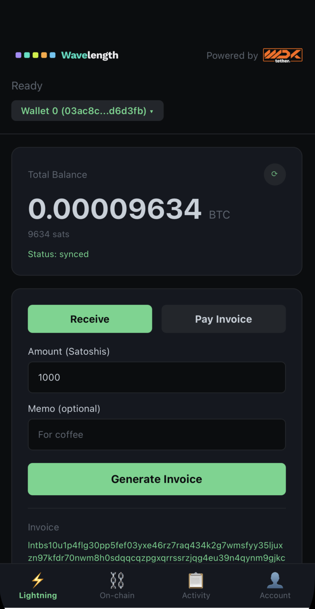

# Wavelength WDK Mobile App

Wavelength/WDK wallet demo running on React Native

<p align="center">
  
</p>

## Usage

```sh
npm install
```

Build the worklet bundle. It isn't committed, so do this before the first run
and again after changing `worklet/driver-wdk.mjs` or the wallet package:

```sh
npm run build:worklet-bundle
```

### iOS

```sh
npm run ios
```

### Android

```sh
npm run android
```

On every `expo prebuild` the wallet's Expo plugin makes sure the iOS
xcframework and the Android `.aar` are staged, and adds the addon's pod.
`react-native.config.js` keeps `@lightninglabs/wavelength-react-native` off
iOS, where the addon already links the daemon.

## License

MIT
